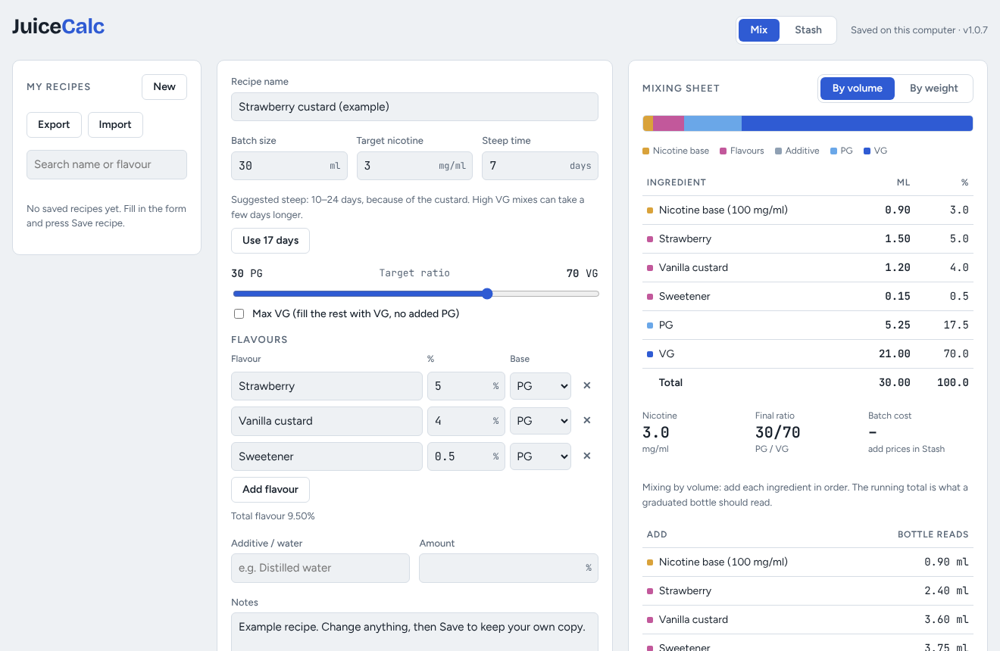
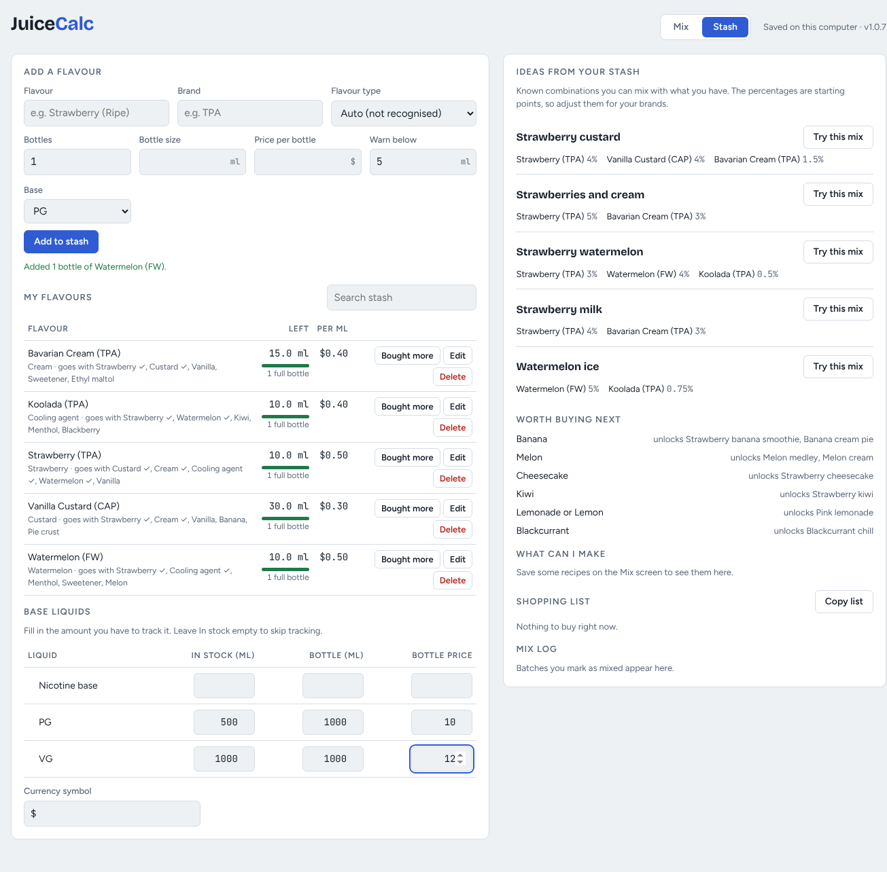
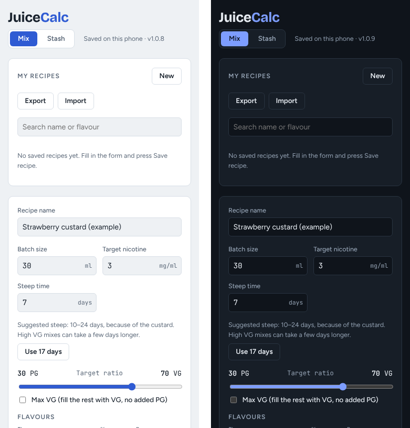

# Juice Calc

An e-liquid mixing calculator with a recipe library and flavour stash tracker. It runs on Windows, Linux and Android, works offline, and keeps all of your data on your own device.



## Features

**Mixing calculator**
- Enter a batch size, target nicotine strength, PG/VG ratio and any number of flavours.
- Get the amount of each ingredient, plus a running "bottle reads" total so you can pour straight into one graduated bottle.
- Mix **by volume** (ml, the default) or **by weight** (grams, using per-ingredient densities).
- **Max VG** mode fills all remaining room with VG and adds no extra PG.
- Accounts for the PG/VG in your nicotine base and in each flavour, so the final ratio is what you asked for.
- Supports an additive or distilled water line.

**Recipes**
- Save, search, copy and duplicate recipes.
- **Suggested steep time** for each recipe, based on the slowest-steeping flavour type in it (custards and bakery take longer than fruit), with a one-tap "Use N days" button.
- Copy any recipe as plain text to share it.

**Flavour stash**
- Track each flavour's brand, bottles on hand, bottle size, price and a low-stock warning level.
- Track PG, VG and nicotine base stock and prices.
- See the cost of every batch and a stock check before you mix.
- "I mixed this batch" takes the amounts out of stock and adds the batch to a mix log, with undo.
- **What can I make** with what's on hand, a **shopping list** of what's running low, **pairing ideas** from a built-in guide of 78 flavour types and 72 classic combinations, and **worth buying next** suggestions that unlock new recipes.



**Android**
- The same app on your phone, following the phone's light or dark theme.



**Export and import**
- Export everything (recipes, stash, base liquids, nicotine settings and mix log) to one file.
- Import it on another computer or phone, and choose to merge it with what's there or replace it. Replace keeps a backup of the old data first.

## Download and install

Download the latest version from [Releases](https://github.com/bctripster/juice-calc/releases).

### Linux (AppImage)
```sh
chmod +x JuiceCalc-*-x86_64.AppImage
./JuiceCalc-*-x86_64.AppImage
```
The AppImage runs on most 64-bit Linux distributions without installing anything. Only one copy of the app runs at a time, so your saves never overwrite each other.

### Windows 10 and 11
- **Installer:** run `JuiceCalc-Setup-*.exe`. You can choose the install folder, and it adds Start menu and desktop shortcuts.
- **Portable:** `JuiceCalc-*-portable.exe` runs without installing.

The app isn't code-signed, so Windows SmartScreen may say it "protected your PC". Click **More info**, then **Run anyway**.

### Android (APK)
Requires Android 5.0 or newer.
- **With a computer:** turn on USB debugging on the phone, then run `adb install -r JuiceCalc-*.apk`.
- **On the phone:** copy the APK over, open it, and allow installs from that app when Android asks.

Installing a newer APK over an older one keeps your data.

## Where your data is kept

Nothing leaves your device. There are no accounts, no analytics and no network requests.

| Platform | Location |
| --- | --- |
| Windows | `%APPDATA%\juice-calc\juicecalc.json` (File > Open data folder in the app) |
| Linux | `~/.config/juice-calc/juicecalc.json` (File > Open data folder in the app) |
| Android | The app's private storage. Use Export to make a copy you can keep or move. |

The desktop and Android apps keep separate data. To move it between them, use **Export** on one and **Import** on the other.

## How the maths works

For a batch of size *B* ml:

- **Nicotine base** = *B* × target strength ÷ base strength
- **Each flavour** = *B* × flavour % ÷ 100
- **VG to add** = (*B* × target VG %) − VG already supplied by the nicotine base and flavours, limited to the room that's left
- **PG to add** = whatever room remains

In weight mode, each volume is multiplied by its density. The defaults are nicotine base 1.01, PG 1.036, VG 1.261 and water 1.00 g/ml, and you can change them under "My nicotine base and densities".

## Build from source

### Desktop
Requires Node.js 20 or newer.
```sh
cd desktop
npm install
npm start          # run from source
npm run dist       # build the Linux AppImage into desktop/dist/
npm run dist:win   # build the Windows installer and portable .exe (needs Wine on Linux)
```

### Android
The Android app is a small WebView wrapper around the same files in `desktop/app/`. `android/build.sh` builds it without Gradle. On Debian or Ubuntu it needs JDK 17 and these packages: `android-sdk`, `android-sdk-platform-23`, `aapt2`, `apksigner`, `zipalign` and `dalvik-exchange`.
```sh
cd android
./build.sh         # signed APK in android/build/
```
The signing key isn't in this repository. `build.sh` makes a new one the first time it runs. Android only installs an update over an existing install when both are signed with the same key, so keep yours safe. See [android/README.md](android/README.md) for details.

## Project layout

```
desktop/
  app/index.html     UI and mixing maths
  app/stash.js       stock matching, deductions, undo and costs
  app/pairings.js    flavour types, pairing guide and steep times
  app/main.js        Electron main process: storage, menus, export/import
  app/preload.js     the storage API the page uses
android/
  src/.../MainActivity.java   WebView, storage bridge, file picker, theme
  android-bridge.js           gives the page the same storage API as desktop
  build.sh                    builds and signs the APK
docs/                         screenshots
```

## Versions

Each build bumps the last number (1.0.1, 1.0.2 and so on). Change notes are in [desktop/README.md](desktop/README.md) and [android/README.md](android/README.md).

## Safety

Juice Calc is a calculator, not safety advice. Nicotine concentrate is toxic, both swallowed and through the skin. Wear gloves when handling it, label everything, and keep it away from children and pets. Check your numbers before you mix, especially with high-strength nicotine base.

## License

[MIT](LICENSE) © 2026 bctripster

The bundled fonts (Bricolage Grotesque, Figtree and JetBrains Mono) are under the SIL Open Font License. Electron is under the MIT License.
